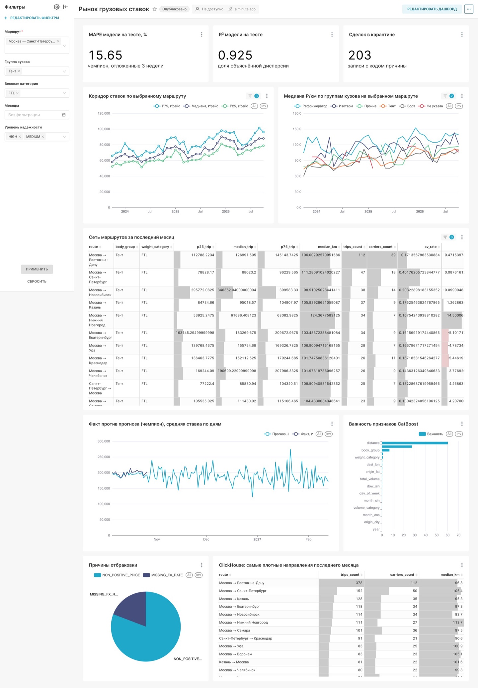
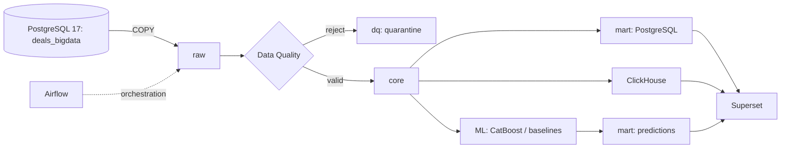
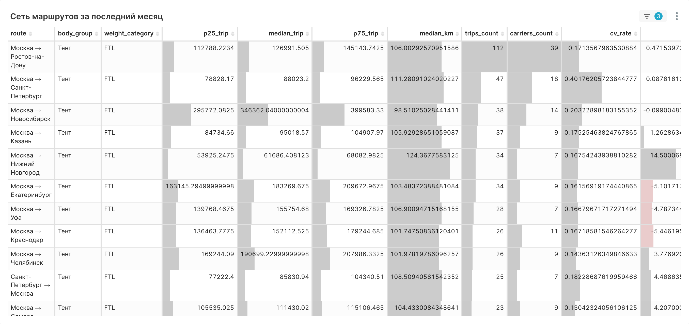
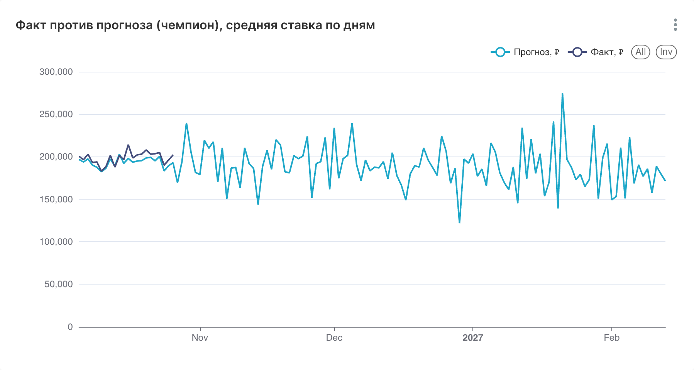

# Smart Logistics Data & ML Platform

Платформа аналитики и прогнозирования тарифов автомобильных грузоперевозок. Конвейер на Python обрабатывает сделки, приводит цены к рублям, контролирует качество данных, рассчитывает рыночные ставки в PostgreSQL и ClickHouse и выполняет пакетное прогнозирование с помощью CatBoost. Результаты доступны в Apache Superset.

**Что можно узнать:** рыночный коридор P25–P75 в ₽/рейс и ₽/км; изменение медианы MoM/YoY; число рейсов и уникальных перевозчиков; надёжность оценки; отклонение факта от прогноза.



## Архитектура



| Слой | Назначение |
|---|---|
| `raw` | Копия данных источника |
| `dq` | Карантин с кодами причин отклонения |
| `core` | Очищенные факты, категории и измерения |
| `mart` | Карточка маршрута, сетевая сводка и прогнозы |
| `ml` | Запуски моделей и метрики |
| `etl` | Журнал выполнения и состояние обновления |

Реализация и причины выбора технологий — в [архитектурной документации](docs/architecture.md).

## Быстрый старт

Нужны Docker Desktop и не менее **8 ГБ памяти**, выделенной Docker. Из корня репозитория:

```bash
docker compose up --build
```

Для запуска также с Airflow:

```bash
docker compose --profile airflow up --build
```

| Сервис | Адрес | Локальный вход |
|---|---|---|
| Superset | http://localhost:8088/superset/dashboard/freight-rates/ | `admin / admin` |
| PostgreSQL (`dwh`, `deals_bigdata`) | `localhost:5432` | `postgres / change-me-postgres` |
| ClickHouse | http://localhost:8123 | `freight / change-me-clickhouse` |
| Airflow (дополнительный профиль) | http://localhost:8080 | `admin / admin` |

Это демонстрационные учётные данные только для локального стенда. Настройки можно переопределить через `.env` по образцу `.env.example`.

## Результаты

На детерминированном синтетическом наборе из **300 000** сделок: **299 797** загружены в `core`, **203** отправлены в карантин. Витрина включает **203 644** месячные ячейки; в заявленной проверке ClickHouse и PostgreSQL расхождений нет. Эти значения относятся к стандартному набору данных и проверяются при повторном запуске.

Модели сравниваются по временному разбиению относительно даты снимка `2026-10-26`. На **очищенной тестовой выборке** (`test`, 12 808 строк):

| Модель | R² | MAPE | RMSE, ₽ | MAE, ₽ |
|---|---:|---:|---:|---:|
| **CatBoost** | **0,928** | **13,85 %** | **51 238** | **26 133** |
| Дерево решений | 0,909 | 15,86 % | 57 574 | 30 211 |
| Гребневая регрессия | 0,842 | 49,35 % | 75 943 | 47 801 |

**Улучшение качества модели.** Первоначально CatBoost обучался на цене рейса непосредственно в рублях и показывал MAPE **15,65 %** и R² **0,925**. Поскольку в синтетических данных используется мультипликативный логнормальный шум, целевая переменная была переведена в логарифмическую шкалу (`ln(price_rub)`). После обучения прогноз возвращается в рубли через `exp()`. Это снизило MAPE на очищенном тесте до **13,85 %** (на **1,8 п. п.**) и повысило R² до **0,928** без изменения целевой величины прогноза. Подробности — в [документации ML](docs/ml.md).

На **полном тесте с размеченными выбросами** (`test_unfiltered`, 13 078 строк) CatBoost показывает **R² 0,805 и MAPE 17,2 %**. Числа приведены по последнему опубликованному прогону; перед сдачей их следует воспроизвести локально. Описание признаков, метрик и ограничений — в [документации ML](docs/ml.md).

## Дашборд

В Superset доступны фильтры маршрута, группы кузова, весовой категории, месяцев и надёжности; коридор ставок, сеть маршрутов, факт против прогноза, качество модели и причины отбраковки.





## Проверка и документация

```bash
make test
make test-integration
make smoke
```

Повторная обработка одного и того же окна должна сохранять бизнес-результаты без дублей. Подробный сценарий запуска, сравнения PostgreSQL/ClickHouse, тестов, Airflow и Superset — в [docs/testing.md](docs/testing.md).

- [ETL, правила качества и расчёт витрин](docs/data-pipeline.md)
- [Архитектура, обновление и идемпотентность](docs/architecture.md)
- [ML, эксперименты и ограничения](docs/ml.md)
- [Ручная проверка и автоматические тесты](docs/testing.md)

**Ограничение исходных данных:** сделки за последний день снимка, `2026-10-26`, ещё не прошли ночную разметку выбросов. У них `outlier_mark=false`, поэтому неразмеченные аномалии могут влиять на октябрьский рыночный коридор. Это ограничение не исправляется произвольной переоценкой флага в обязательном ETL.

## Структура репозитория

```text
common/       конфигурация, подключение к БД, логирование
etl/          загрузка, очистка, витрины и ClickHouse
ml/           признаки, модели, обучение и скоринг
configs/      параметры моделей
dags/         Airflow DAG
sql/          источник, DWH, витрины, проверки
tests/        модульные и интеграционные тесты
docker/       образы и скрипты инициализации
docs/         техническая документация и снимки дашборда
```

## Лицензия

MIT
