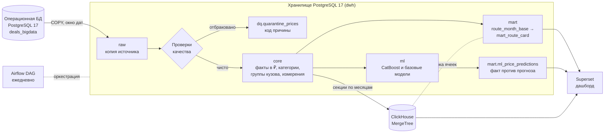

# Ставки грузоперевозок: аналитика и прогноз

Платформа данных для рынка автомобильных грузоперевозок: собирает сделки из операционной базы, очищает их, считает рыночный коридор ставок по маршрутам и прогнозирует справедливый тариф рейса моделью градиентного бустинга. Результат доступен в виде витрин PostgreSQL и ClickHouse и готового дашборда Superset.

Проект отвечает на четыре вопроса логиста и закупщика:

1. Какую ставку ставить на маршрут? — медиана рынка и коридор P25–P75 в ₽/рейс и ₽/км.
2. Насколько цена соответствует рынку сейчас? — динамика к прошлому месяцу и к прошлому году.
3. Можно ли доверять цифре? — число рейсов, число независимых перевозчиков, разброс цены и уровень надёжности.
4. Насколько закрытые рейсы отклоняются от прогноза? — таблица «факт против прогноза» по каждой сделке.

Весь контур поднимается одной командой и работает на детерминированных синтетических данных: 300 тыс. сделок за три года с реалистичными краевыми случаями.

```bash
docker compose up
```

## Архитектура



Слои хранилища:

| Слой | Что лежит | Как обновляется |
|---|---|---|
| `raw` | Копия нужных таблиц источника без бизнес-правил | Окно дат погрузки целиком заменяется в одной транзакции, справочники — полным снимком |
| `dq` | Отбракованные сделки, по строке на каждую нарушенную проверку | Заменяется вместе с окном |
| `core` | Очищенные сделки в рублях, категории, группы кузова, помесячная развёртка, справочник городов без дублей | Окно заменяется атомарно, затронутые месяцы помечаются для потребителей |
| `mart` | Карточка маршрута, сводка по сети, сводка качества, прогнозы | Пересчитываются только затронутые месяцы, тонкое представление обновляется без блокировки чтения |
| `ml` | Запуски моделей, метрики, важность признаков | Каждый запуск — новая запись журнала, прогнозы — снимок |
| `etl` | Журнал шагов, очередь «грязных» месяцев, параметры снимка | Служебный |

## Почему такой стек

- **PostgreSQL 17** — основное хранилище. Перцентили (`percentile_cont`), материализованные представления с `REFRESH CONCURRENTLY`, транзакционная замена окна — всё, что нужно для честных пересчётов без внешних инструментов.
- **Python + pandas** для проверок и обогащения: правила качества — чистые векторные функции, их легко покрыть модульными тестами без базы. Перенос данных — только потоковым `COPY`, без построчных вставок.
- **SQL** для витрин: тяжёлая агрегация остаётся рядом с данными, эталонный запрос лежит отдельным файлом и читается без Python.
- **ClickHouse** — аналитический слой для больших объёмов. Коридор пересчитывается средствами самого ClickHouse (`quantileExactInclusive` интерполирует так же, как `percentile_cont`), и после каждой синхронизации ячейки сверяются с PostgreSQL.
- **CatBoost** — нативно работает с категориями (регионы, города, группа кузова), не требует масштабирования и на табличных данных стабильно обходит базовые модели. Для сравнения обучаются гребневая регрессия и дерево решений.
- **Airflow** — расписание и повторы задач. Каждый шаг идемпотентен, поэтому повтор безопасен.
- **Superset** — дашборд создаётся автоматически при старте контейнера.

## Быстрый старт

Нужен только Docker; виртуальной машине Docker стоит выделить не меньше 8 ГБ памяти
(Docker Desktop → Settings → Resources). Все команды ниже выполняются на своей машине
в корне репозитория.

```bash
docker compose up --build
```

Что происходит:

1. `postgres` создаёт роли и базы и генерирует источник. На быстрой машине это пара минут,
   на Intel Mac 2020 года — около 9 минут; запас проверки готовности — 25 минут.
   Объём источника можно уменьшить переменной `SOURCE_N_PRICES` в `.env`.
2. `clickhouse` поднимает аналитическую базу.
3. `pipeline` один раз прогоняет весь конвейер: извлечение → проверки → витрины → ClickHouse → обучение и скоринг, затем завершается с кодом 0 (ещё 7–10 минут, большая часть — обучение моделей).
4. `superset` подключает хранилище и ClickHouse и собирает дашборд (1–2 минуты).

Итого первый запуск на медленной машине занимает до 20 минут; повторные старты на готовых
томах — меньше минуты.

| Сервис | Адрес | Вход |
|---|---|---|
| Superset, дашборд «Рынок грузовых ставок» | http://localhost:8088/superset/dashboard/freight-rates/ | admin / admin |
| PostgreSQL (`dwh`, `deals_bigdata`) | localhost:5432 | postgres / change-me-postgres |
| ClickHouse HTTP | http://localhost:8123 | freight / change-me-clickhouse |
| Airflow (профиль `airflow`) | http://localhost:8080 | admin / admin |

Пароли по умолчанию прописаны в `docker-compose.yml`. Чтобы задать свои, скопируйте `.env.example` в `.env`.

С оркестрацией по расписанию:

```bash
docker compose --profile airflow up --build
```

Частые команды из `Makefile`:

```bash
make backfill                                        # полный пересчёт
make rerun-window START=2026-10-01 END=2026-10-31    # повтор окна дат, ничего не задваивает
make test                                            # модульные тесты
make test-integration                                # тесты на поднятом хранилище
make smoke                                           # smoke-проверки: все нули — порядок
make analyze                                         # отчёт о достижимой точности модели
make reset                                           # удалить тома и начать с нуля
```

## Этап 1. Извлечение, проверки качества, загрузка

Конвейер параметризуется окном дат погрузки (`--start`, `--end` или `logical_date` в Airflow). Окно извлекается из источника потоковым `COPY` в согласованном снимке (`REPEATABLE READ`) и заменяет то же окно в `raw` и `core` в одной транзакции. Сделка, у которой в источнике поменялась дата погрузки, заменяется по идентификатору, поэтому две версии одной сделки не появятся.

Проверки качества (`etl/dq.py`). Нарушившая строка не теряется: в `dq.quarantine_prices` попадает запись с кодом причины.

| Код | Условие |
|---|---|
| `NON_POSITIVE_PRICE` | `price <= 0` |
| `RUB_PRICE_TOO_LOW` | рубли и `price <= 1000` — не цена рейса |
| `NON_POSITIVE_DISTANCE` | `distance <= 0` |
| `NEGATIVE_WEIGHT`, `NEGATIVE_VOLUME` | отрицательный вес или объём |
| `UNKNOWN_LOADING_CITY`, `UNKNOWN_UNLOADING_CITY` | города нет в справочнике |
| `UNKNOWN_CURRENCY` | валюта не 643, 840, 978 |
| `MISSING_FX_RATE` | валюта, а точного курса ЦБ на `nearest_rate_date` нет |

Пересчёт валют идёт строго по курсу на `nearest_rate_date`: в источнике эта дата заполняется относительно `created_at`, подмена датой погрузки не делается. Пустые весовые и объёмные категории дозаполняются по правилам ниже, а в `core` остаётся признак, что категория рассчитана конвейером.

| Весовая категория | Вес, т (округлён до 0,1) |
|---|---|
| `G20T` | ≥ 30 |
| `FTL` | [10; 30) |
| `10T` | [5; 10) |
| `5T` | [2,5; 5) |
| `L5T` | [0,5; 2,5) |
| `OTH` | < 0,5 |

Объёмная категория: `FTL` при 0 < V ≤ 120 м³, иначе `OTH`. Округление повторяет `round(numeric, 1)` PostgreSQL, граничные случаи вроде 9,95 т → `FTL` закреплены тестами.

Результат на синтетическом наборе: из 300 000 сделок 203 отбракованы (164 с нулевой ценой и 39 валютных без курса), 299 797 загружены в `core`.

## Этап 2. Витрины

### Устранение структурных искажений

- **Дубли городов.** `cities.gc_id` в источнике не уникален: у Москвы и Казани по две строки. `core.dim_city` хранит одну строку на `gc_id` с минимальным `cities.id`, город и регион разобраны из `full_name_local` («Казань, Республика Татарстан» → «Казань», «Республика Татарстан»). Соединение со справочником не размножает сделки — это проверяется тестом.
- **Группы кузова.** Сделка может ссылаться на несколько дочерних типов кузова. `core.fact_price_body_group` хранит не более одной строки на пару «сделка, группа»: тент 56 и полная растентовка 61 дают одну строку «Тент». Если связей нет, берётся `prices.body_type`, затем «Не указан».

| Группа | Коды |
|---|---|
| Тент (56) | 56, 57, 58, 59, 60, 61 |
| Рефрижератор (4) | 4, 46, 47, 48 |
| Изотерм (2) | 2 |
| Борт (15) | 1, 15 |
| Прочие (0) | остальные |
| Не указан (−1) | нет кузова |

- **Долгосрочные заявки.** Месяц берётся из `price_dates`, поэтому заявка на квартал попадает в каждый свой месяц ровно один раз.

### Карточка маршрута и коридор ставок

Зерно: **месяц × город отправления × город назначения × группа кузова × весовая категория**. Эталонный запрос — [`sql/mart/route_month_base.sql`](sql/mart/route_month_base.sql).

В выборку попадают только фактические прямые перевозки (`is_fact`, `price_type IN (1,2,3,4,5,9)`, `NOT complex`) с положительными ценой и расстоянием, рассчитанной ставкой в рублях и без отметки выброса. Даты после даты снимка `2026-10-26` в историю рынка не входят.

| Поле | Смысл |
|---|---|
| `p25_trip`, `median_trip`, `p75_trip`, `avg_trip` | коридор и среднее, ₽/рейс без НДС |
| `p25_km`, `median_km`, `p75_km` | коридор, ₽/км |
| `trips_count` | уникальных сделок в ячейке |
| `carriers_count` | уникальных перевозчиков (`price_type IN (3, 9)`) |
| `cv_rate` | `stddev_samp / avg`; пусто при одном наблюдении |
| `mom_pct`, `yoy_pct` | изменение медианы к календарному прошлому месяцу и к тому же месяцу год назад; пусто, если такой ячейки нет |
| `reliability_level` | `HIGH`: ≥ 30 рейсов, ≥ 5 перевозчиков, последняя дата не старше 30 дней от даты снимка; `MEDIUM`: ≥ 10 рейсов; иначе `LOW_DATA` |
| `volume_ftl_share` | доля рейсов объёмной категории FTL — атрибут, не часть зерна |

Устройство: тяжёлые агрегаты лежат в таблице `mart.route_month_base` и пересчитываются только по «грязным» месяцам. Над ней — материализованное представление `mart.mart_route_card` с динамикой, уровнем надёжности и названиями. Оно обновляется целиком за секунды и без блокировки чтения. Для сценария тендера есть `mart.v_route_network` — сеть маршрутов за последний месяц.

Итог: 203 644 ячейки.

### ClickHouse

`freight.fact_market_rows` и `freight.route_month_base` — `ReplacingMergeTree(_version)`, секции по месяцам. Синхронизация удаляет секции затронутых месяцев и вставляет их заново, поэтому повтор ничего не задваивает. Коридор считается запросом [`sql/clickhouse/route_month_base.sql`](sql/clickhouse/route_month_base.sql) по тем же правилам, представление `freight.route_card` повторяет динамику и уровень надёжности.

После каждой синхронизации ячейки сверяются с PostgreSQL. На полном наборе: 203 644 ячейки с обеих сторон, расхождений 0. Если сверка не проходит, задача Airflow падает.

## Этап 3. Признаки, обучение, пакетный скоринг

Цель — фактическая ставка рейса в рублях без НДС (`price_rub`).

**Разбиение строго по времени** от даты снимка, а не от текущей даты:

| Выборка | Даты погрузки |
|---|---|
| обучение | `2026-07-26` включительно — `2026-10-05` не включительно |
| тест | `2026-10-05` — `2026-10-26` включительно |
| будущие заявки | после `2026-10-26` |

Граница `2026-10-05` входит только в тест. Ранняя остановка CatBoost подбирается на последних двух неделях обучающего окна, затем модель переобучается на всём окне с найденным числом деревьев.

**Признаки** (`ml/features.py`):

- география раздельно для отправления и назначения: регион, город, широта, долгота;
- расстояние, вес, объём, группа кузова, весовая и объёмная категории, тип записи;
- календарь: год, месяц, день недели, день года и их синус и косинус с периодами 12, 7 и 365,25.

Тип записи (`price_type`) — это признак, а не утечка: он известен в момент создания заявки, до
того как цена назначена, и несёт устойчивый ценовой сигнал — заявка перевозчика в среднем дешевле
заявки заказчика. Модель учит эту разницу, а не подсматривает целевую ставку. Если нужен нейтральный
рыночный ориентир без привязки к роли автора записи, скоринг можно выполнять с зафиксированным
`price_type` (например, прямой заказ `9`) — сами признаки это допускают.

**Защита от утечек:**

- список запрещённых полей (`price_with_vat`, удельные ставки текущей сделки, маржа, агрегаты `price_group_stats`, `price_group_id`, флаг выброса) проверяется при каждом построении матрицы;
- очистка цели — по `outlier_mark` и межквартильному порогу на ln(₽/км), посчитанному только на обучении;
- заполнение пропусков, масштабирование и кодирование категорий базовых моделей живут внутри `Pipeline` и обучаются только на обучающей выборке;
- зерно генераторов фиксировано, результат воспроизводится до последнего знака.

**Метрики на тесте** (полный набор, 300 тыс. сделок):

| Модель | R² | MAPE, % | RMSE, ₽ | MAE, ₽ |
|---|---:|---:|---:|---:|
| **CatBoost** | **0,925** | **15,65** | **52 508** | **27 258** |
| Дерево решений | 0,907 | 16,28 | 58 395 | 30 702 |
| Гребневая регрессия | 0,842 | 49,35 | 75 943 | 47 801 |

Тест без строк с отметкой выброса — 12 808 сделок. На полном тесте вместе с выбросами (13 078 сделок) у CatBoost R² 0,801 и MAPE 19,0 %. Отчёт каждого запуска — в `artifacts/ml/metrics.md`, история — в `ml.model_metrics`.

### Предел точности на этих данных

Насколько 15,65 % — это хорошо? Ответ даёт отчёт `make analyze` (модуль [`ml/analysis.py`](ml/analysis.py),
результат — `artifacts/ml/accuracy_analysis.md`; модуль, а не блокнот, потому что он проходит линтер и
воспроизводится одной командой без лишних зависимостей):

- Генератор источника накладывает на цену логнормальный шум `exp(0,16·Z)`, поэтому даже модель,
  точно знающая детерминированную часть цены, получает MAPE **12,9 %**. Узкие полосы выбросов ×4 и
  ×0,25, которые ночная разметка не помечает никогда (0,4 % строк), поднимают этот пол до **13,4 %**.
- Фактические 15,65 % раскладываются так: 65 строк теста (0,5 %) с неразмеченными выбросами дают
  1,0 п. п. — без них 14,75 %; неразмеченный последний день снимка чуть хуже остальных
  (16,2 % против 15,6 %); оставшиеся ~2 п. п. — аппроксимация на коротком обучающем окне в 10 недель.
- Базовая модель «медиана ячейки маршрута из обучения» даёт MAPE **30,6 %** (R² 0,774) — модель
  вдвое точнее простого справочника медиан.
- MAPE гребневой регрессии 49 % — не ошибка реализации, а свойство линейной модели на
  мультипликативных ценах: на нижнем дециле цены её MAPE 224 %, и два нижних дециля дают 59 %
  всей суммы относительной ошибки, при этом R² (0,842) остаётся высоким.

**Скоринг.** Все три модели оценивают тестовый период и 4 891 будущую заявку. Результат записывается в `mart.ml_price_predictions` с признаком лучшей модели. У будущих заявок фактическая ставка, абсолютная и относительная ошибка пустые, даже если в источнике заполнена плановая цена — это закреплено ограничением таблицы.

## Оркестрация в Airflow

DAG `freight_rates_pipeline` (`dags/`): `migrate → extract → transform → build_marts → [sync_clickhouse, train_and_score]`.

Окно по умолчанию скользящее: от начала интервала минус 14 дней до конца интервала плюс 150 дней. Отставание назад подхватывает поздние правки источника, например ночную разметку выбросов, а горизонт вперёд — плановые заявки для скоринга. Ручная дозагрузка за любой период:

```bash
docker compose exec airflow airflow dags trigger freight_rates_pipeline \
  --conf '{"start_date": "2023-01-01", "end_date": "2027-12-31"}'
```

## Дашборд Superset

Создаётся скриптом [`docker/superset/bootstrap.py`](docker/superset/bootstrap.py) при каждом старте контейнера. Скрипт идемпотентен.

Наверху дашборда — нативные фильтры: **маршрут**, **группа кузова**, **весовая категория**,
**диапазон месяцев** и **уровень надёжности**. По умолчанию выбраны Москва → Санкт-Петербург,
тент, FTL и уровни `HIGH`/`MEDIUM`; пользователь переключает их сам, графики ничего не зашивают.
Маршрут и месяцы управляют карточкой маршрута, уровень надёжности — сводной таблицей,
кузов и вес — и тем и другим.

- MAPE и R² лучшей модели, число строк в карантине;
- коридор P25–P50–P75 по выбранному маршруту (детальная карточка);
- медиана ₽/км по группам кузова на выбранном маршруте;
- сеть маршрутов за последний месяц (сводный анализ для тендера);
- средняя фактическая и прогнозная ставка по дням, включая будущие заявки;
- важность признаков CatBoost, причины отбраковки;
- самые плотные направления последнего месяца — запрос к ClickHouse.

BI подключается ролью `bi_reader`, у которой есть только чтение.

## Проверка результата

```sql
-- Коридор ставок по маршруту
SELECT month, route, body_group, weight_category,
       round(p25_trip) AS p25, round(median_trip) AS p50, round(p75_trip) AS p75,
       round(median_km::numeric, 1) AS rub_per_km, trips_count, carriers_count,
       round(mom_pct::numeric, 1) AS mom, round(yoy_pct::numeric, 1) AS yoy, reliability_level
FROM mart.mart_route_card
WHERE route = 'Москва → Санкт-Петербург' AND body_group = 'Тент' AND weight_category = 'FTL'
ORDER BY month DESC
LIMIT 12;

-- Самые надёжные направления последнего месяца
SELECT route, body_group, weight_category, round(median_trip) AS p50, trips_count, carriers_count
FROM mart.v_route_network
WHERE reliability_level = 'HIGH'
ORDER BY trips_count DESC;

-- Почему отбракованы строки
SELECT reason_code, sum(rows_quarantined) FROM mart.v_dq_quarantine_summary GROUP BY 1;

-- Рейсы, закрытые заметно выше прогноза
SELECT price_id, loading_date, body_group, round(actual_price_rub) AS fact,
       round(predicted_price_rub) AS forecast, round(ape_pct::numeric, 1) AS error_pct
FROM mart.ml_price_predictions
WHERE is_champion AND split = 'test' AND actual_price_rub > predicted_price_rub * 1.3
ORDER BY ape_pct DESC
LIMIT 20;

-- Журнал запусков
SELECT step, status, window_start, window_end, finished_at - started_at AS took, metrics
FROM etl.run_log ORDER BY run_id DESC LIMIT 10;
```

Пример карточки маршрута Москва → Санкт-Петербург, тент, FTL:

| Месяц | P25 | P50 | P75 | ₽/км | Рейсов | Перевозчиков | MoM, % | YoY, % | Надёжность |
|---|---:|---:|---:|---:|---:|---:|---:|---:|---|
| 2026-10 | 78 828 | 88 023 | 96 230 | 111,3 | 47 | 18 | 0,1 | 18,3 | HIGH |
| 2026-09 | 76 737 | 87 946 | 101 327 | 111,2 | 32 | 13 | 4,3 | 20,8 | HIGH |
| 2026-08 | 75 923 | 84 345 | 95 057 | 106,6 | 33 | 11 | 5,1 | 10,4 | MEDIUM |

Через ClickHouse:

```sql
SELECT month, route, median_trip, trips_count, reliability_level
FROM freight.route_card
WHERE route = 'Москва → Санкт-Петербург' AND body_group = 'Тент' AND weight_category = 'FTL'
ORDER BY month DESC LIMIT 3;
```

## Идемпотентность

Каждый шаг можно повторить за тот же период без последствий:

- извлечение и очистка заменяют окно в одной транзакции (`DELETE` + `COPY`);
- витрина пересчитывает только затронутые месяцы, полный пересчёт даёт тот же результат;
- ClickHouse заменяет секции месяцев;
- прогнозы — снимок, заменяемый целиком;
- миграции написаны через `IF NOT EXISTS`.

Это закреплено тестами: два повтора окна подряд и полный пересчёт витрин не меняют ни одного счётчика и ни одной суммы.

## Тесты

- **Модульные (53)** — без базы: граничные значения категорий, каждая проверка качества, пересчёт валют, схлопывание групп кузова, разбор региона, границы разбиения по времени, циклические признаки, запрет полей-утечек, метрики.
- **Интеграционные (5)** — на поднятом хранилище: повтор окна, равенство полного и частичного пересчёта, smoke-проверки ([`sql/checks/smoke.sql`](sql/checks/smoke.sql), 14 инвариантов — от потерянных сделок до независимого пересчёта числа рейсов), отсутствие размножения сделок справочником городов, совпадение ClickHouse с PostgreSQL (на встроенном ClickHouse — chdb).
- **CI** (`.github/workflows/ci.yml`) — линтер, модульные тесты и полный прогон конвейера с интеграционными тестами на PostgreSQL 17.

## Известные особенности данных

- **Последний день снимка не размечен.** Сделки за `2026-10-26` ещё не прошли ночную разметку выбросов, у них `outlier_mark = false`. Базовое решение флаг не пересчитывает, поэтому выбросы этого дня попадают в октябрьскую витрину: разброс `cv_rate` по маршруту Москва → Санкт-Петербург в октябре 0,40 против 0,16–0,21 в предыдущие месяцы. В Airflow окно с отставанием назад перечитает эти сделки после разметки в источнике.
- **Маршрут внутри одного города** не отбраковывается: исходная задача сохраняет такую пару вместе с расстоянием. Строка остаётся в `core` с признаком `same_city_route`. В синтетическом наборе таких нет.
- **Свежесть для уровня надёжности** считается от последней даты сделки в ячейке до даты снимка. Поэтому старые месяцы не могут получить `HIGH`: на конец снимка у них нет свежих наблюдений.
- **География в важности признаков мала** (около 1 %): в генераторе цена зависит от расстояния, кузова, тоннажа и сезона, но не от региона. На реальных данных вклад регионов заметно выше.
- `price_group_stats` не используется нигде: его агрегаты содержат предсказываемую сделку.

## Структура репозитория

```
├── common/            конфигурация из окружения, JSON-логи, работа с PostgreSQL
├── etl/               извлечение, проверки качества, очистка, витрины, ClickHouse, командная строка
├── ml/                набор данных, признаки, разбиение, модели, обучение и скоринг
├── dags/              DAG Airflow
├── sql/
│   ├── source/        схема и генератор операционной базы
│   ├── dwh/           миграции слоёв raw, core, dq, etl, mart, ml и права BI
│   ├── mart/          эталонный запрос карточки маршрута
│   ├── clickhouse/    таблицы MergeTree, расчёт коридора, представление
│   └── checks/        smoke-проверки
├── tests/             модульные и интеграционные тесты
├── docker/            образы конвейера, Superset, Airflow, инициализация PostgreSQL
├── docker-compose.yml
└── .env.example
```

## Запуск без Docker

Нужны Python 3.11+ и PostgreSQL с базами `deals_bigdata` и `dwh`. Подключения задаются переменными из `.env.example`.

```bash
pip install -r requirements-dev.txt
export POSTGRES_HOST=localhost CLICKHOUSE_ENABLED=false
python -m etl.cli all                                       # полный прогон
python -m etl.cli etl --start 2026-10-01 --end 2026-10-31   # повтор окна
python -m etl.cli marts --full-refresh                      # пересчёт всех месяцев витрины
pytest -q                                                   # модульные тесты
RUN_INTEGRATION=1 pytest -q                                 # плюс интеграционные
```

## Лицензия

MIT
